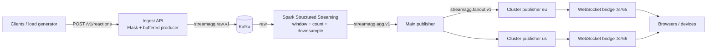

# StreamAgg-Spark — generic realtime stream aggregation platform

A generic, horizontally scalable starter for **high-volume categorical event streams**
(live audience reactions, votes, clicks, sensor tags — anything shaped like
`{"user_id", "reaction", "timestamp"}`): ingest → Kafka → Spark micro-batch
aggregation → Kafka fan-out → WebSocket delivery. Send tens of thousands of events per
second; every ~2 seconds each connected client receives one small aggregated window instead of a
firehose of raw events.

> Renamed and rebuilt from a college emoji-broadcast prototype. All course-specific branding
> (`EmoStream`, team IDs), vendor-specific copy (league/team names, streaming-provider references),
> broken experiment folders, and placeholder files were removed. The legacy code is preserved on the
> `backup/legacy-emostream` branch for reference.

## Architecture



**Pipeline stages** (`config.py` is the single source of truth; every topic/interval/port is env-driven):

| Stage | Code | In → Out |
|---|---|---|
| Ingest | `app/ingest_api.py` (+ `app/schemas.py`) | `POST /v1/reactions` → `streamagg.raw.v1` |
| Aggregate | `streaming/spark_processor.py` (+ `streaming/aggregation.py`) | raw → `streamagg.agg.v1` (one JSON doc per window) |
| Fan-out 1:N | `fanout/main_publisher.py` | agg → `streamagg.fanout.v1` |
| Fan-out N:M | `fanout/cluster_publisher.py` | fan-out → `streamagg.fanout.v1.<cluster>` |
| Push | `fanout/websocket_bridge.py` | cluster topic → WebSocket |

Downsampling keeps viral spikes cheap: `DOWNSAMPLE_PER_UNIT=1000` means 2,500 raw `cheer`
reactions in a window ship as `{"reaction": "cheer", "count": 2, "raw_count": 2500}`.

## Quickstart

```bash
cp .env.example .env            # optional; defaults work locally
pip install -r requirements.txt
# Spark job only:
pip install -r requirements-spark.txt

make up                            # Kafka on localhost:9092
make api                           # ingest on :5000 (health: GET /healthz)
make spark                         # in another terminal (needs Java + Spark)
make main                          # agg -> fanout forwarder
make cluster bridge                # CLUSTER=default shard + WS :8765
make load RPS=100 DURATION=30      # smoke traffic
python client/websocket_client.py  # watch aggregated windows
```

Or supervise the non-Spark stages in one terminal:

```bash
python tools/run_all.py --with-load --clusters default --load-rps 50
```

Demo UI (generic — type any event title, no hardcoded fixtures):

```bash
streamlit run client/demo_frontend.py
```

## API

`POST /v1/reactions` → `202 {"status": "accepted"}` (legacy alias `POST /send_emoji` kept).

```json
{ "user_id": "user123", "reaction": "applause", "timestamp": "2026-10-09T12:00:00Z" }
```

- `reaction` also accepts the legacy `emoji_type` key; `timestamp` accepts ISO-8601 or epoch seconds.
- `400` on validation failure, `503` when the broker/buffer is unavailable — never a fake success.
- `GET /healthz` → `{"status": "ok", "kafka": "up"}`; `GET /v1/stats` → ingest counters.

Aggregated window example on Kafka/WS:

```json
{
  "window_start": "2026-10-09T12:00:00.000Z",
  "window_end": "2026-10-09T12:00:02.000Z",
  "reactions": "[{\"reaction\":\"cheer\",\"count\":2,\"raw_count\":2500}]",
  "cluster_id": "eu"
}
```

## Configuration

See `.env.example`. Key knobs: `KAFKA_BOOTSTRAP_SERVERS`, `RAW/AGG/FANOUT_TOPIC`,
`WINDOW_SECONDS`, `DOWNSAMPLE_PER_UNIT`, `PRODUCER_FLUSH_INTERVAL_SEC`, `WS_PORT`.

## Scaling guide

- **Ingest:** stateless — run N replicas behind a load balancer; raise `PRODUCER_QUEUE_MAX` and Kafka partitions on `streamagg.raw.v1`.
- **Spark:** raise partitions to match cores; keep trigger == window; checkpoint on durable storage (default `/tmp/streamagg-checkpoint` is local-only).
- **Fan-out:** one `cluster_publisher` + `websocket_bridge` pair per shard (region/venue/edge); consumers use distinct group ids per shard so each gets a full copy.
- **Clients:** windows are idempotent per `(window_start, cluster_id)` — safe to reconnect and dedupe.

## Tests

```bash
python -m pytest tests/ -q
```

- `test_schemas.py` — validation rules, legacy alias, timestamp normalization.
- `test_ingest_api.py` — Flask test client + fake producer (no broker needed).
- `test_aggregation_logic.py` — downsampling math and window sorting without Spark.

## What was removed / fixed vs the prototype

- Removed: course header/team branding, hardcoded league match + team names, streaming-vendor references, `dealing_with_client/` broken WebSocket experiments (syntax errors, `asyncio.run` inside the consume loop, calling a set as a function), `front/` wrong-endpoint UI with random fake counts masking failures, `web_sockets/` duplicate half-implemented bridge referencing an undefined handler, `run_script*.py` gnome-terminal-only launchers, infinite 200-thread load test with no exit, zero-byte placeholder file.
- Fixed: per-request thread + blocking `flush()` → bounded buffer + timer flush; scattered hardcoded topics/ports → `config.py` + env; three disagreeing topic names → versioned `streamagg.*.v1`; `debug=True` → production-safe defaults; silent failures → 400/503 + structured logs + graceful SIGTERM handling.
